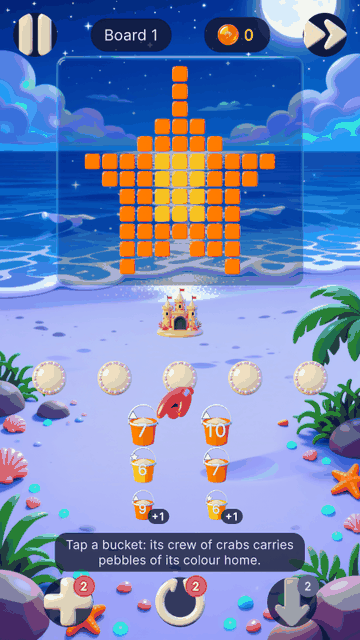
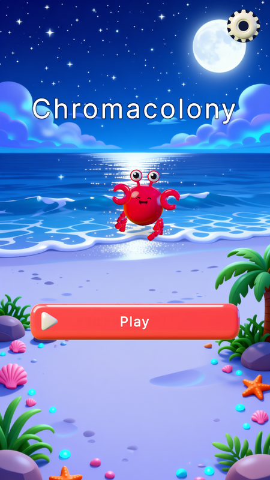
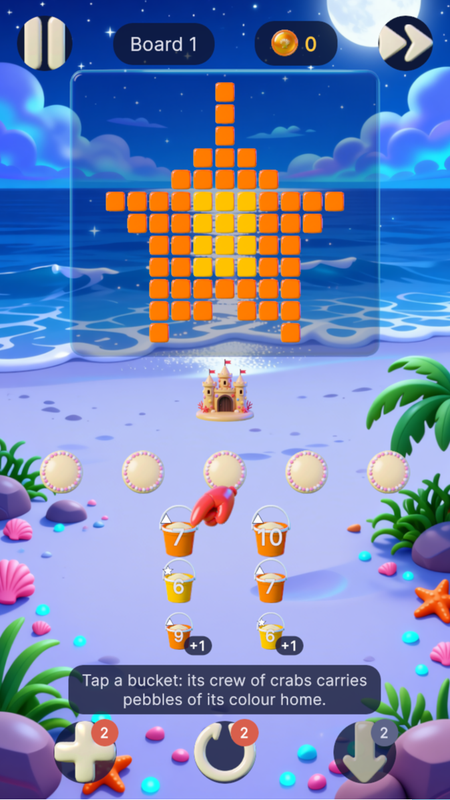
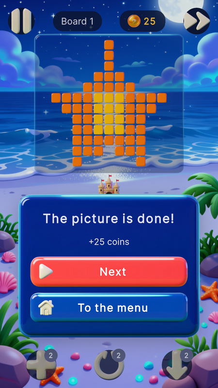
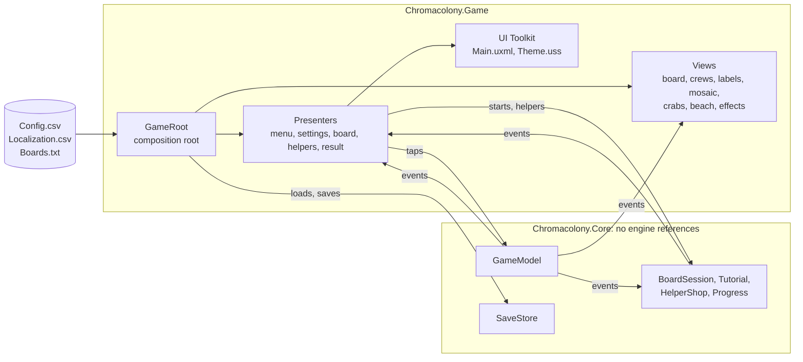

# Chromacolony

A puzzle game that runs in the browser, laid out for a phone held upright. Crews of crabs wait in columns of buckets under a mosaic, one colour to a bucket. Tap a column and the crew at its front takes one of five slots; its crabs then carry the pebbles of their colour home, one at a time. A board is done when every pebble is home, and then the picture puts itself together again.



**Play it in the browser:** [andrewboykodeveloper.itch.io/chromacolony](https://andrewboykodeveloper.itch.io/chromacolony)

  

## Status

Version 1.0.0: twenty boards, in English and Russian. Three helpers ease a hard board: an extra slot for the board, a shuffle of the queue, and a crew sent back to the queue. They come from a small stock, and then for coins won on boards. The changes are in the [changelog](CHANGELOG.md).

## How it is built

- **The rules are plain C#** in an assembly of their own that cannot reference the engine. They cover the board, the crews, the crabs, the helpers, the coins, the saves and the tutorial. Time enters only through a fixed-step tick and chance only through a seeded generator, so the same taps at the same ticks, with the same seed, give the same board. EditMode tests run the rules in milliseconds.
- **The Unity side shows the rules and passes the taps in.** One composition root builds the game and wires it by hand. The model raises C# events, and the views and the presenters follow them.
- **The interface is UI Toolkit:** one layout and one style sheet.
- **The data is in text files:** two CSV tables, for the numbers and the texts, and one file for the boards.



The [architecture overview](docs/architecture/overview.md) shows how the parts fit together and what one frame does.

## Unity version

Unity 6000.6.7f1, the version the game was built with. It is a supported Unity 6 release, not an LTS one. The project uses URP's 2D renderer, UI Toolkit, the Input System and C# 9.

## Open, test and build

- **Open:**
  1. Install 6000.6.7f1 through Unity Hub, with the Web Build Support module.
  2. Add the folder in Unity Hub and open it.
  3. Open `Assets/_Project/Scenes/Game.unity`.
- **Test:** use **Window > General > Test Runner**, or run from a shell:

  ```sh
  Unity -batchmode -projectPath . -runTests -testPlatform EditMode -testResults Logs/EditMode.xml
  Unity -batchmode -projectPath . -runTests -testPlatform PlayMode -testResults Logs/PlayMode.xml
  ```

  - **EditMode** tests cover the rules, a solver over every shipped board, a deterministic replay, the saves, the tables, the interface's element names and the board's hit tests.
  - **PlayMode** tests boot the scene and play the game through its interface: they press only the buttons a player could see and reach, and tap the board with a virtual mouse. Others switch the game off and on or destroy it, and check the input, the dialog fade and the safe area on their own.

- **Build for the web:** use **Chromacolony > Build > Web**, or run from a shell:

  ```sh
  Unity -batchmode -quit -projectPath . -buildTarget WebGL -executeMethod Chromacolony.Editor.BuildCommands.BuildWeb
  ```

  The build goes to `Builds/Web`.

In these commands, `Unity` stands for the editor's executable, which Unity Hub installs under `Hub/Editor/6000.6.7f1/`. Close the editor before you run them: a project opens in one Unity at a time.

## Layout

```
Assets/
  _Project/
    Art/  Audio/  Data/  Prefabs/  Scenes/  UI/
    Scripts/
      Core/        Chromacolony.Core         the rules, no engine references
      Game/        Chromacolony.Game         the composition root, presenters, views and services
      Editor/      Chromacolony.Editor       the import rules and the web build command
    Tests/
      EditMode/    Chromacolony.Tests.EditMode
      PlayMode/    Chromacolony.Tests.PlayMode
  Settings/        the render pipeline's assets
  WebGLTemplates/  the web page
docs/
  architecture/    the overview and the decision records
  media/           the pictures used here
```

## Docs

- [Architecture overview](docs/architecture/overview.md)
- Decision records:
  - [Keep the rules in a C# assembly with no engine references](docs/architecture/adr/0001-rules-in-a-pure-csharp-assembly.md)
  - [Build the interface with UI Toolkit](docs/architecture/adr/0002-ui-toolkit.md)
  - [Keep the numbers, the texts and the boards in text files](docs/architecture/adr/0003-data-in-tables.md)
- [Changelog](CHANGELOG.md)

## History

The game began as a quick prototype. The first commit imports it as it was, and the pull requests after it are the pass that brought it to a maintainable release.

The history follows git-flow, with `--no-ff` merges. Every commit after the first, apart from the merges, follows Conventional Commits.

## Credits and license

© 2026 Andrew Boyko. The code, art and audio are published for viewing and evaluation only; see the [license](LICENSE). The Inter font and Unity's web template keep their own licenses; see the [third-party notices](THIRD-PARTY-NOTICES.md).
